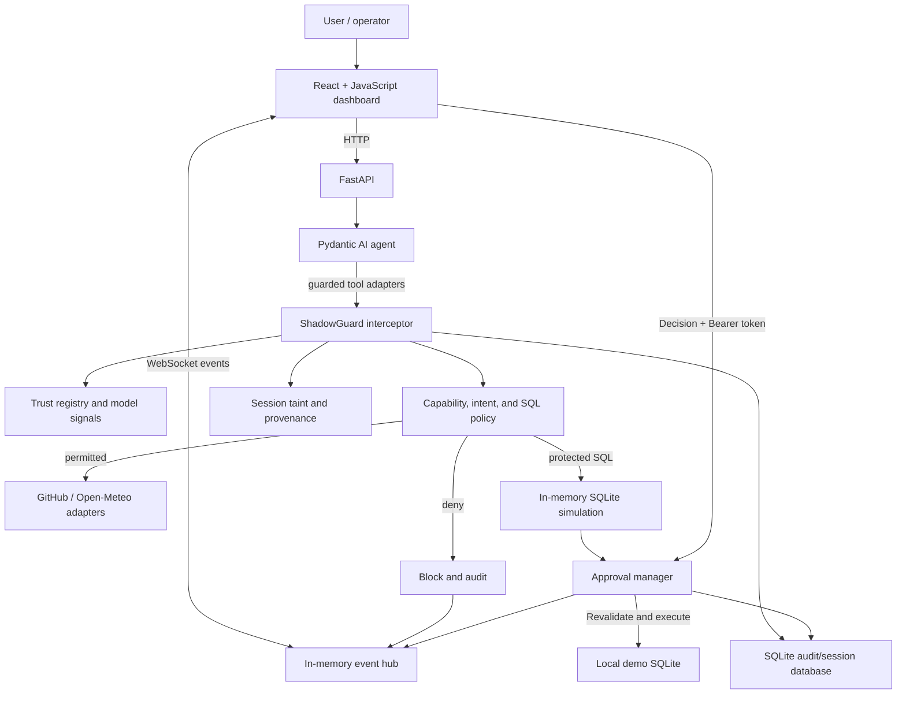

# Project Title — ShadowGuard AI

> A local demonstration of a policy gateway for AI-agent tool calls. It combines deterministic authorization rules, trust signals, session-scoped taint tracking, SQLite shadow simulation, and token-gated human decisions.

## Contents

- [Project Overview](#project-overview)
- [Problem Statement](#problem-statement)
- [Our Solution](#our-solution)
- [Key Features](#key-features)
- [What Makes ShadowGuard AI Different](#what-makes-shadowguard-ai-different)
- [System Architecture](#system-architecture)
- [End-to-End Workflow](#end-to-end-workflow)
- [Technology Stack](#technology-stack)
- [Machine Learning and Risk Detection](#machine-learning-and-risk-detection)
- [Security Model and Trust Classification](#security-model-and-trust-classification)
- [Unintended Action Detection and Policy Enforcement](#unintended-action-detection-and-policy-enforcement)
- [Shadow-State and Human Approval Workflow](#shadow-state-and-human-approval-workflow)
- [Cross-Server Taint Tracking](#cross-server-taint-tracking)
- [Installation and Prerequisites](#installation-and-prerequisites)
- [Environment Configuration](#environment-configuration)
- [How to Run the Project](#how-to-run-the-project)
- [How to Use the Application](#how-to-use-the-application)
- [Project Structure](#project-structure)
- [API Endpoints and MCP Integration](#api-endpoints-and-mcp-integration)
- [Security, Privacy, and Limitations](#security-privacy-and-limitations)
- [Testing and Validation](#testing-and-validation)
- [Performance and Evaluation](#performance-and-evaluation)
- [Demo and Screenshots](#demo-and-screenshots)
- [Research Papers and Technical References](#research-papers-and-technical-references)
- [External Repositories and Open-Source Credits](#external-repositories-and-open-source-credits)
- [AI Tools Used](#ai-tools-used)
- [Datasets and Model Training](#datasets-and-model-training)
- [Team and Contributions](#team-and-contributions)
- [Future Improvements](#future-improvements)
- [License](#license)
- [Acknowledgements](#acknowledgements)

## Project Overview

ShadowGuard AI is a local web application that intercepts the tool calls made by an AI agent and evaluates them before execution. The repository demonstrates a security gateway for agent integrations: proposed actions are checked against configured tool trust, explicit capabilities, deterministic action policy, model-based signals, and session taint. Outcomes include allowing a permitted call, blocking it, staging it for approval, or returning an explicit integration error.

The project is a **security-focused prototype**, not a production identity provider or a general-purpose MCP proxy. The current chat path runs guarded tools inside the FastAPI application.

## Problem Statement

An agent that reads external content and can also call tools may receive hostile or misleading instructions in tool output. If that content influences later tool calls, an otherwise valid capability can be used outside the user's intent. High-impact operations also need review before they affect protected state.

## Our Solution

The backend wraps the agent's available tools with a policy interceptor. It records the sources of returned external data, checks later calls against session and action rules, and simulates eligible SQL operations against an in-memory SQLite copy before any protected database change. A human decision is required for staged actions; the decision endpoint requires a shared operator bearer token.

## Key Features

- **Guarded tool execution** through a central interceptor used by the chat agent.
- **Trust evaluation** combining a weighted evidence score with optional synthetic-model signals; hard policy checks remain authoritative.
- **Session taint and provenance** for outputs from registered integrations, including source tool and affected fields where available.
- **Action and SQL policy checks** for declared capabilities, supported statement types, and permitted tables.
- **SQLite shadow simulation** and approval staging before protected SQL mutations.
- **Revalidation at decision time** for staged action integrity, expiry, tool policy, taint context, and database snapshot.
- **Approval operator bearer token** required to approve or reject; an unset token fails closed.
- **Live GitHub and Open-Meteo adapters**, with repository allowlisting, bounded requests, explicit failures, and provenance.
- **React dashboard** for chat, trust zones, live events, approval review, and demo scenarios.

## What Makes ShadowGuard AI Different

The demonstrator puts several complementary controls in one agent-tool execution path: **deterministic authorization and SQL rules, model signals, session-level data provenance, pre-execution simulation, and an explicit operator decision**. Model scores do not grant permissions. The implementation and its limits are documented rather than presented as a production guarantee.

## System Architecture



The editable diagram is [`docs/architecture.mmd`](docs/architecture.mmd). See the [architecture and developer guide](docs/SHADOWGUARD_ARCHITECTURE.md) for module details and the [execution and performance notes](docs/edge-first-architecture.md) for measured local observations.

## End-to-End Workflow

1. A user submits a chat request to FastAPI; the backend creates or verifies the session and records request metadata.
2. The Pydantic AI agent selects among its registered guarded tools.
3. The interceptor checks registration, enabled state, authorized capabilities, trust policy, intent signals, taint, and action-specific rules.
4. Permitted integrations run. GitHub and weather results are treated as untrusted external content and can taint the session.
5. Eligible SQL is evaluated against a disposable in-memory SQLite snapshot. Protected actions are staged rather than executed immediately.
6. An operator reviews the staged action and submits a decision with `Authorization: Bearer <APPROVAL_OPERATOR_TOKEN>`.
7. The approval manager revalidates the action and snapshot before execution, then records audit/provenance events for the dashboard.

## Technology Stack

| Layer | Verified dependencies (manifest version) | Role |
|---|---|---|
| Backend/API | `fastapi==0.115.5`, `uvicorn==0.35.0`, `pydantic==2.11.7` | HTTP API, server, and validation |
| Agent/tool layer | `pydantic-ai-slim[openai]==0.4.3`, `fastmcp==3.4.0` | Agent orchestration/provider and FastMCP tool declarations |
| Backend utilities | `httpx==0.28.1`, `python-dotenv==1.1.1`, `sqlparse==0.5.3`, `opentelemetry-api==1.40.0` | HTTP client, environment loading, SQL parsing, instrumentation API dependency |
| Models/persistence | `scikit-learn==1.7.2`, `joblib==1.6.0`, SQLite (Python standard library) | Synthetic classifiers, model serialization, local databases |
| Backend tests | `pytest==8.4.2`, `pytest-asyncio==1.0.0` | Test runner and async tests |
| Frontend runtime | `react@^18.3.1`, `react-dom@^18.3.1`, `lucide-react@^0.468.0` | UI rendering and icons |
| Frontend build/style | `vite@^6.0.7`, `@vitejs/plugin-react@^4.3.4`, `tailwindcss@^4.3.3`, `@tailwindcss/vite@^4.3.3` | Development/build pipeline and styling |

Upstream repositories, roles, and license identifiers are listed in [External Repositories and Open-Source Credits](#external-repositories-and-open-source-credits). Versions and dependency ranges are taken from the manifests, not a runtime lockfile inference.

Dependency versions are pinned in [`backend/requirements.txt`](backend/requirements.txt) and [`frontend/package.json`](frontend/package.json); `frontend/package-lock.json` records the frontend dependency resolution.

## Machine Learning and Risk Detection

The saved model bundle contains a **Random Forest trust classifier** and a **TF-IDF plus Logistic Regression intent classifier**. The included trainer uses a generated synthetic demonstration dataset; no operational or external training dataset is documented. The trust model contributes a score when available, and the intent model emits `INTENDED`, `POTENTIALLY_UNINTENDED`, or `UNCERTAIN`.

These are **signals, not authorization**. Deterministic capability, trust, SQL, taint, and policy checks remain authoritative. The held-out synthetic metrics in [`docs/ml-security-models.md`](docs/ml-security-models.md) are reproducibility/wiring results only and do not establish real-world detection performance. Model artifact/runtime version compatibility is also a documented limitation.

## Security Model and Trust Classification

The trust registry evaluates tool evidence across identity/authentication, permissions, behavior, data handling, and relationships. By default, the weighted evidence score and model score are combined at 70%/30%, with a threshold of 70; configuration is validated. Failed mandatory checks can force a low-trust classification regardless of the score. The current model classification maps to a calculated `LOW` or `HIGH` zone (there is no calculated `MEDIUM` band); the **higher of that calculated zone and the administrator-configured `LOW`/`MEDIUM`/`HIGH` zone** becomes the effective zone.

The configured integration zone (`LOW`, `MEDIUM`, `HIGH`) is distinct from the model classification (`LOW_TRUST`, `HIGH_TRUST`). Session taint blocks access to tools whose effective zone is `HIGH`; `MEDIUM` is not implicitly treated as `HIGH`.

## Unintended Action Detection and Policy Enforcement

Each chat request carries an objective and an authorized capability list. The interceptor checks the proposed action's scope, tool status, intent signals, taint context, and deterministic action rules. SQL policy supports a limited set of statement types and tables; unsupported or prohibited statements are rejected. An ML classification cannot expand the caller's capabilities or override a deterministic block.

## Shadow-State and Human Approval Workflow

Eligible database operations are simulated against an in-memory SQLite copy. The pending action binds the proposed operation to integrity data and a database snapshot fingerprint. At decision time the backend rechecks expiry, action integrity, identity/session context, current tool policy, taint sources, SQL policy, and the database fingerprint before a transaction executes the staged SQL.

The decision endpoint requires the shared `APPROVAL_OPERATOR_TOKEN` as a Bearer credential of at least 32 UTF-8 bytes. Missing or incorrect credentials are rejected; an unset or weak server token returns HTTP 503. The dashboard asks for the token in the confirmation dialog and does not persist it. This is **not** per-person authentication or role-based authorization. Other API routes, including the pending-approval read route, are not protected by this token.

## Cross-Server Taint Tracking

Taint is persisted at the **session level** with source-tool and affected-field provenance. This lets the interceptor apply a tainted-session policy across registered tools. The implementation does not model separate MCP servers or maintain a server-to-server taint graph; “cross-server” tracking is therefore not a distinct implemented capability.

## Installation and Prerequisites

- Windows PowerShell instructions below assume the existing root `.venv`; Python 3.10.8 is the local environment documented for measurements.
- Node.js/npm are needed for the Vite frontend.
- A model-provider API key is required to use LLM chat. Live GitHub private-repository access additionally requires a GitHub token. The weather integration uses Open-Meteo.

## Environment Configuration

From the repository root, copy the template only when a local file does not already exist:

```powershell
if (-not (Test-Path .\backend\.env)) { Copy-Item .\backend\.env.example .\backend\.env }
notepad .\backend\.env
```

Set `MODEL_NAME` and the matching `OPENAI_API_KEY` or `OPENROUTER_API_KEY`. For example, the template defaults to `openai:gpt-4o-mini`. Set `APPROVAL_OPERATOR_TOKEN` to a randomly generated secret; generate one with:

```powershell
python -c "import secrets; print(secrets.token_urlsafe(32))"
```

Set `GITHUB_REPOSITORY` and `GITHUB_ALLOWED_REPOSITORIES` to the repository/repositories the GitHub reader may access; set `GITHUB_TOKEN` only when authenticated GitHub API access is needed. The `.env` file is ignored by Git. **Never commit it or paste secret values into issues, logs, screenshots, or documentation.** Restart the backend after changing configuration.

## How to Run the Project

Install backend requirements and start the API from the repository root:

```powershell
.\.venv\Scripts\Activate.ps1
python -m pip install -r .\backend\requirements.txt
python -m uvicorn app.main:app --app-dir backend --reload --host 127.0.0.1 --port 8000
```

In another terminal, install frontend dependencies and run Vite:

```powershell
Set-Location .\frontend
npm ci
npm run dev
```

Open `http://localhost:5173`. The development server proxies `/api` and `/ws` to the backend. To build static frontend assets, run `npm run build` from `frontend`. For offline integration tests/demos, set `SHADOWGUARD_INTEGRATION_MODE=fixture`; this does not remove the model-provider requirement for chat.

## How to Use the Application

- Use **Chat** to ask for a read or a protected database action.
- Review trust classifications, configured zones, audit events, and provenance in the dashboard.
- Use the scenario controls to stage a destructive SQL action or demonstrate a tainted-session block.
- To approve or reject a staged action, open **Approvals**, review the exact operation and taint sources, then enter the backend's operator token in the confirmation dialog.
- A pending action is not evidence that the database was changed; the decision response and audit events show the terminal result.

## Project Structure

```text
backend/
  app/                  FastAPI, agent, integrations, policy/security modules
  data/                 SQL fixture used by the local integration demo
  scripts/              Model trainer and runtime benchmark
  tests/                Backend tests, including mocked remote-provider tests
docs/
  architecture.mmd      Editable current architecture diagram
  SHADOWGUARD_ARCHITECTURE.md
  edge-first-architecture.md
  implementation-plan.md
  ml-security-models.md
  TECHNICAL_WRITEUP.md
frontend/
  src/                  React dashboard
  package.json          Frontend dependencies and scripts
```

## API Endpoints and MCP Integration

| Method | Endpoint | Purpose / authorization |
|---|---|---|
| `GET` | `/api/health` | Health check |
| `POST` | `/api/chat` | Chat request and guarded agent execution |
| `GET`, `POST` | `/api/integrations` | List integrations / update configured trust zone |
| `GET` | `/api/approvals/pending` | List pending actions; currently unauthenticated |
| `POST` | `/api/approvals/{approval_id}/decision` | Approve/reject; requires `Authorization: Bearer <APPROVAL_OPERATOR_TOKEN>` |
| `GET` | `/api/security/events` | Recent in-memory security events |
| `GET` | `/api/trace`, `/api/trace/{request_id}` | Request/audit trace queries |
| `POST` | `/api/demo/scenario-a`, `/api/demo/scenario-b` | Local demonstration flows |
| WebSocket | `/ws` | Live in-memory event stream |

The code declares FastMCP tools, but the FastAPI application does **not** start a standalone MCP stdio/HTTP transport. The chat agent currently uses guarded Pydantic AI tool functions. See [`backend/app/mcp_server.py`](backend/app/mcp_server.py) before describing this as an interoperable MCP proxy.

## Security, Privacy, and Limitations

- The documented backend command binds to `127.0.0.1`. The Vite configuration currently binds to `0.0.0.0`; because most API routes have no authentication or per-user authorization, do not run the frontend on an untrusted network. Set the Vite host to `127.0.0.1` for a strictly local demo.
- The operator token is a shared bearer secret, not a named identity. Pending-approval reads and integration configuration are not protected by it.
- SQLite databases, the default `demo-user`, and demo integrations are local prototype components, not a production data boundary.
- External tool outputs are untrusted. Model signals are synthetic-data trained and are not a security guarantee.
- The taint model is session-scoped, not an MCP-server graph. EventHub state is in memory; SQLite audit persistence is separate.
- Configure TLS and a real identity/authorization layer before exposing the service beyond a trusted local environment. Do not commit `.env` files, database files, private keys, or provider credentials.
- The repository has no checked-in `LICENSE`; its redistribution terms have not been specified.

## Testing and Validation

Run backend tests from the root:

```powershell
.\.venv\Scripts\python.exe -m pytest .\backend\tests
```

The suite covers gateway decisions, approvals, taint, ML behavior, chat response safety, and mocked GitHub/Open-Meteo requests. Mock transports do not prove live provider access. Build the dashboard with `npm run build` from `frontend`. For the benchmark invocation and caveats, see [`docs/edge-first-architecture.md`](docs/edge-first-architecture.md).

## Performance and Evaluation

[`docs/edge-first-architecture.md`](docs/edge-first-architecture.md) records local trust-inference, intent-inference, and SQLite-shadow-simulation observations and describes its benchmark setup. Those measurements came from one local Windows/Python 3.10.8 environment; they exclude remote calls and are not controlled production benchmarks. Synthetic classifier scores are not operational accuracy metrics.

## Demo and Screenshots

The React dashboard and scenario flows are the available demo interface. No verified screenshots, slide deck, or video are currently included in the repository; add only material that has been reviewed for private information and credentials. The HTML audit/repair report mentioned in earlier notes is not present in the checked-in project.

## Research Papers and Technical References

No research papers or literature review are cited in the repository. The implementation references these upstream technical resources:

- [Model Context Protocol specification](https://modelcontextprotocol.io/specification/)
- [FastMCP documentation](https://gofastmcp.com/)
- [Pydantic AI documentation](https://ai.pydantic.dev/)
- [FastAPI documentation](https://fastapi.tiangolo.com/)
- [GitHub Contents API](https://docs.github.com/en/rest/repos/contents)
- [Open-Meteo API documentation](https://open-meteo.com/en/docs)
- [SQLite documentation](https://www.sqlite.org/docs.html)

These are technical/API references, not claims that the application provides a complete external MCP transport.

## External Repositories and Open-Source Credits

No separate external application repository is recorded as a source of copied or adapted project code. The direct dependencies identified in the manifests are credited below; each remains under its upstream license. The project does not bundle a consolidated transitive-license report.

| Dependency | Version / use | Upstream repository | License |
|---|---|---|---|
| FastAPI | `0.115.5`; backend HTTP API | [fastapi/fastapi](https://github.com/fastapi/fastapi) | MIT |
| Uvicorn | `0.35.0`; ASGI server | [encode/uvicorn](https://github.com/encode/uvicorn) | BSD-3-Clause |
| Pydantic | `2.11.7`; schemas and validation | [pydantic/pydantic](https://github.com/pydantic/pydantic) | MIT |
| Pydantic AI | `0.4.3`; agent/provider integration | [pydantic/pydantic-ai](https://github.com/pydantic/pydantic-ai) | MIT |
| OpenAI Python SDK | Installed through the `pydantic-ai-slim[openai]` extra; compatible model-provider requests | [openai/openai-python](https://github.com/openai/openai-python) | MIT |
| FastMCP | `3.4.0`; tool declarations | [jlowin/fastmcp](https://github.com/jlowin/fastmcp) | Apache-2.0 |
| HTTPX | `0.28.1`; remote API client | [encode/httpx](https://github.com/encode/httpx) | BSD-3-Clause |
| python-dotenv | `1.1.1`; `.env` loading | [theskumar/python-dotenv](https://github.com/theskumar/python-dotenv) | BSD-3-Clause |
| sqlparse | `0.5.3`; SQL statement parsing | [andialbrecht/sqlparse](https://github.com/andialbrecht/sqlparse) | BSD-3-Clause |
| scikit-learn | `1.7.2`; synthetic trust/intent classifiers | [scikit-learn/scikit-learn](https://github.com/scikit-learn/scikit-learn) | BSD-3-Clause |
| joblib | `1.6.0`; model serialization | [joblib/joblib](https://github.com/joblib/joblib) | BSD-3-Clause |
| OpenTelemetry API | `1.40.0`; declared dependency (no direct application use found) | [open-telemetry/opentelemetry-python](https://github.com/open-telemetry/opentelemetry-python) | Apache-2.0 |
| pytest | `8.4.2`; backend test runner | [pytest-dev/pytest](https://github.com/pytest-dev/pytest) | MIT |
| pytest-asyncio | `1.0.0`; async backend tests | [pytest-dev/pytest-asyncio](https://github.com/pytest-dev/pytest-asyncio) | Apache-2.0 |
| React / React DOM | `^18.3.1`; frontend UI | [facebook/react](https://github.com/facebook/react) | MIT |
| lucide-react | `^0.468.0`; dashboard icons | [lucide-icons/lucide](https://github.com/lucide-icons/lucide) | ISC |
| Vite | `^6.0.7`; frontend dev/build server | [vitejs/vite](https://github.com/vitejs/vite) | MIT |
| @vitejs/plugin-react | `^4.3.4`; Vite React integration | [vitejs/vite-plugin-react](https://github.com/vitejs/vite-plugin-react) | MIT |
| Tailwind CSS / @tailwindcss/vite | `^4.3.3`; utility CSS and Vite plugin | [tailwindlabs/tailwindcss](https://github.com/tailwindlabs/tailwindcss) | MIT |

The external service APIs used by adapters are listed above under [technical references](#research-papers-and-technical-references). See the package manifests for exact pinned/ranged versions and transitive dependencies.

## AI Tools Used

GitHub Copilot through the Copilot SDK in VS Code was used during this submission-preparation session. No reliable project history identifying AI tools used in earlier development is checked in; the project owner should add any verified tools used for coding, research, design, or presentation work. The backend is configured to support OpenAI and OpenRouter model providers, but historical provider/model usage is not available from repository evidence.

## Datasets and Model Training

No external dataset is recorded. `backend/scripts/train_ml_models.py` generates synthetic demonstration examples for the trust and intent models, and the resulting model bundle is stored at `backend/app/security/model_artifacts/shadowguard_models.joblib`. The dataset, metrics, compatibility caveats, and limitations are described in [`docs/ml-security-models.md`](docs/ml-security-models.md). Do not interpret synthetic held-out results as production performance.

## Team and Contributions

No verified team roster, role allocation, or contribution statements are included in the repository. Add names and contributions only after the project owner confirms them.

## Future Improvements

- Add verified operator identity and role-based authorization across all API routes.
- Protect and scope pending-approval, event, integration, and trace endpoints.
- Add server-aware taint provenance and explicit session expiry/cleanup.
- Establish model provenance, operational training/evaluation data, and compatible artifact versions.
- Add approval crash recovery and reconciliation for in-progress actions.
- Provide a real MCP transport boundary if external MCP clients/servers are a goal.
- Add a license, reviewed screenshots/demo materials, and a reproducible deployment guide.

## License

No root-level `LICENSE` file is present. The project license is therefore **unspecified**; third-party dependencies retain their own upstream licenses. The repository owner should select and add a license before redistribution.

## Acknowledgements

Thanks to the maintainers of the upstream libraries and API providers listed in [External Repositories and Open-Source Credits](#external-repositories-and-open-source-credits) and [Research Papers and Technical References](#research-papers-and-technical-references). The [technical write-up](docs/TECHNICAL_WRITEUP.md), [architecture guide](docs/SHADOWGUARD_ARCHITECTURE.md), [ML notes](docs/ml-security-models.md), and [implementation plan](docs/implementation-plan.md) provide additional context; the implementation plan is historical planning material, not a claim that every phase is complete.
