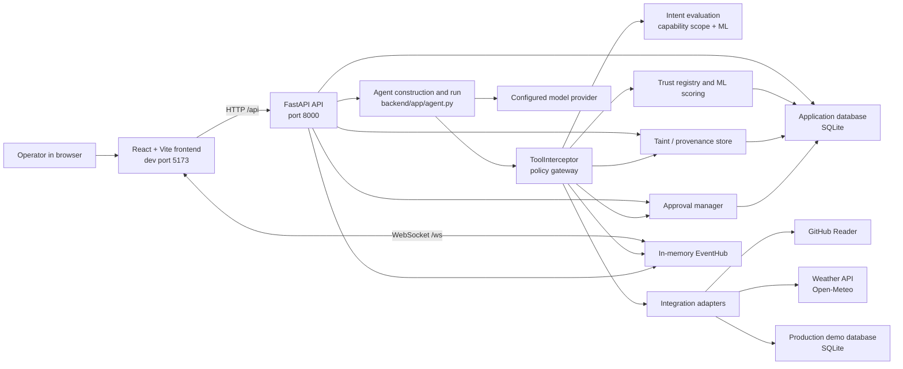
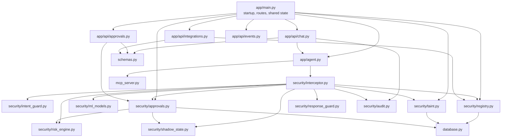
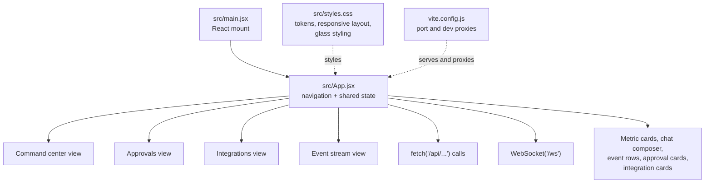
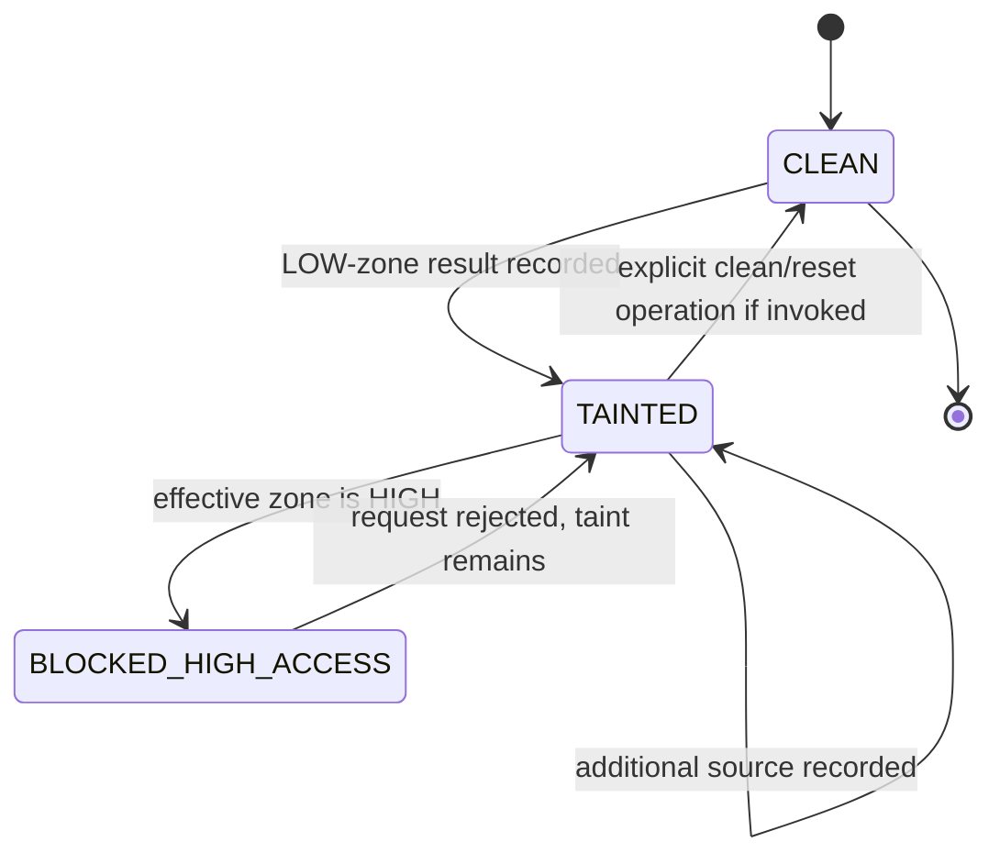
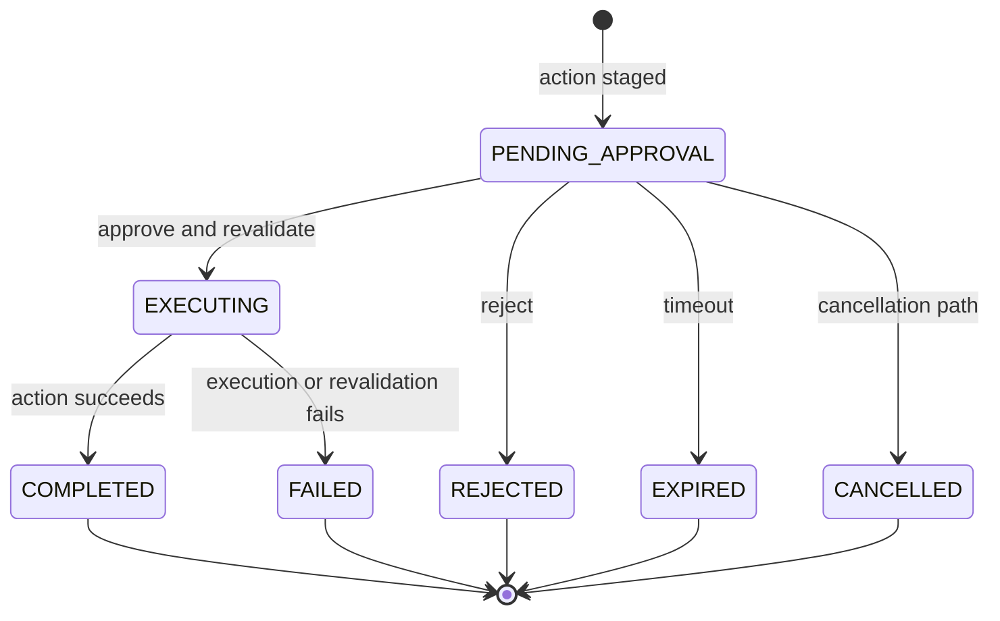
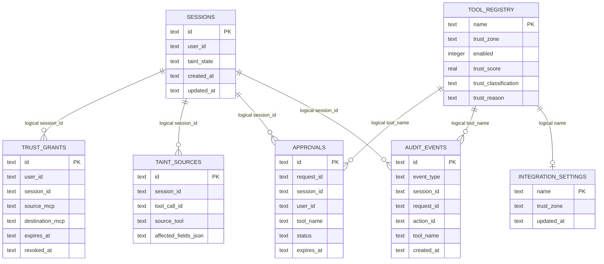
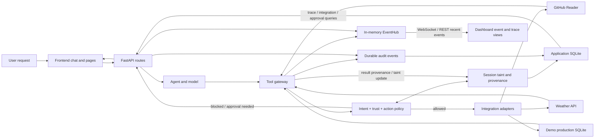
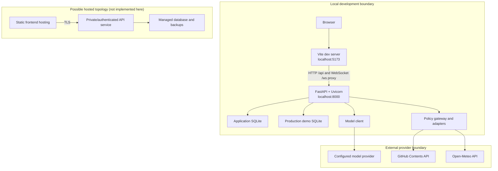

# ShadowGuard Architecture and Developer Guide

> **Plain English:** ShadowGuard is a local web application that places a policy gateway between an AI agent and its tools. It evaluates proposed tool calls, tracks data from lower-trust sources, and can stop or stage sensitive actions for an operator to review. This document describes the implementation in this repository; it does not imply that every control is production-ready.

## Table of contents

1. [Overview](#1-overview)
2. [System architecture](#2-system-architecture)
3. [End-to-end request flow](#3-end-to-end-request-flow)
4. [Trust and security model](#4-trust-and-security-model)
5. [Frontend documentation](#5-frontend-documentation)
6. [Backend and API reference](#6-backend-and-api-reference)
7. [Data flow diagram](#7-data-flow-diagram)
8. [Configuration and setup](#8-configuration-and-setup)
9. [Deployment view](#9-deployment-view)
10. [Extending the system](#10-extending-the-system)
11. [Known gaps, risks, and recommendations](#11-known-gaps-risks-and-recommendations)

## 1. Overview

> **Plain English:** A user asks the agent to do something, such as check the weather. The agent may propose calls to registered integrations, but the gateway evaluates those calls before execution. The dashboard lets an operator observe events, configure integration trust zones, and review pending approvals.

The implementation is a React/Vite dashboard backed by a FastAPI service. The service builds an agent, exposes a small set of tools to it, and routes each tool invocation through `ToolInterceptor`. The gateway combines deterministic checks, model-based intent and trust classification, session taint checks, action policy, and (for selected actions) approval staging. The code is in `frontend/src/App.jsx`, `backend/app/main.py`, `backend/app/agent.py`, and `backend/app/security/interceptor.py`.

The intended problem domain is preventing an AI agent from allowing prompt-injected or otherwise untrusted tool output to steer unsafe tool calls. In the actual implementation, taint is attached to session/tool-result provenance, and the interceptor enforces the configured trust-zone check. This is a demonstrator with a local database and a fixed demo operator identity, not a general multi-tenant identity system (`backend/app/security/taint.py`, `backend/app/api/chat.py`, `frontend/src/App.jsx`).

### Glossary

| Term | Meaning in this repository |
|---|---|
| **Gateway** | `ToolInterceptor`, the central wrapper that checks proposed tool calls and either rejects, stages, simulates, or executes them (`backend/app/security/interceptor.py`). |
| **Integration / tool** | A named agent capability registered in `tool_registry` and exposed by the MCP-like tool layer. Current examples include `github_reader`, `production_database`, and `weather_api` (`backend/app/database.py`, `backend/app/agent.py`, `backend/app/mcp_server.py`). |
| **Trust zone** | Configured `HIGH`, `MEDIUM`, or `LOW` designation for an integration. The effective zone is the higher of the configured zone and the model-derived binary zone (`HIGH_TRUST` → `HIGH`, otherwise `LOW_TRUST` → `LOW`); taint access enforcement specifically checks for effective `HIGH` (`backend/app/security/registry.py`, `backend/app/security/interceptor.py`, `backend/app/security/taint.py`). |
| **Trust classification** | Model/policy output `HIGH_TRUST` or `LOW_TRUST`, distinct from a configured trust zone (`backend/app/security/ml_models.py`, `backend/app/security/registry.py`). |
| **ML score** | The model-derived trust probability converted to a 0–100 score when available (`backend/app/security/ml_models.py`). |
| **Weighted score** | A 0–100 score derived from tool identity, permissions, behavior, data-handling, and relationship evidence (`backend/app/security/registry.py`). |
| **Combined score** | `0.70 × weighted score + 0.30 × ML score` by default. The weights are configurable and validated (`backend/app/security/registry.py`, `backend/app/config.py`). |
| **Taint / tainted session** | Session state and provenance recording that untrusted tool output has entered the session. Successful LOW-zone reads can add taint sources (`backend/app/security/taint.py`, `backend/app/security/interceptor.py`). |
| **Intent evaluation** | Checks an action against the authorized capabilities and asks the intent model whether it appears intended, potentially unintended, or uncertain (`backend/app/security/intent_guard.py`, `backend/app/security/ml_models.py`). |
| **Approval / human in the loop** | A staged, not-yet-executed action that an operator can approve or reject through the API/dashboard. Approval revalidates the staged action and context (`backend/app/security/approvals.py`, `backend/app/api/approvals.py`). |
| **Event stream** | The in-memory `EventHub` and `/ws` WebSocket, plus a REST endpoint for recent in-memory events. This is not SSE and is not the durable audit table (`backend/app/api/events.py`, `backend/app/main.py`). |
| **Workspace** | In this document, the checked-out ShadowGuard repository and the application files under `frontend/` and `backend/`; the code does not define a separate workspace entity. |
| **Operator** | A person using the dashboard to inspect events, configure integration zones, or decide a pending approval. Approval decisions require the configured shared bearer token, but do not establish a verified individual identity (`frontend/src/App.jsx`, `backend/app/api/approvals.py`, `backend/app/security/operator_auth.py`). |

## 2. System architecture

> **Plain English:** The browser talks to one backend service. The backend owns the agent, gateway, security checks, SQLite-backed state, and integration adapters. Live notifications are pushed over a WebSocket; dashboard pages also make ordinary HTTP requests.

### High-level architecture

The frontend's Vite development server listens on port 5173, currently binds `0.0.0.0`, and proxies `/api` and `/ws` to the backend at `127.0.0.1:8000` (`frontend/vite.config.js`). Since most API routes are unauthenticated, use Vite only on a trusted network or change its host to `127.0.0.1` for local-only demos. The backend wiring and integration/tool registration are in `backend/app/main.py`, `backend/app/agent.py`, and `backend/app/mcp_server.py`.



The phrase “ML/trust scoring” here refers to the two distinct model-assisted paths; deterministic capability authorization and action rules remain separate checks. The `EventHub` is in process, while audit records are stored through the audit logger and SQLite (`backend/app/security/interceptor.py`, `backend/app/api/events.py`, `backend/app/database.py`).

### Backend module dependencies

> **Plain English:** The API assembles shared application services at startup. The chat route invokes the agent; the agent wraps its callable tools with the interceptor; the interceptor consults policy/state services before reaching adapters.



Primary module responsibilities are defined in `backend/app/main.py`, `backend/app/api/`, `backend/app/agent.py`, `backend/app/security/`, `backend/app/database.py`, and `backend/app/mcp_server.py`.

### Frontend component dependencies

> **Plain English:** This frontend is a single React application rather than a multi-package frontend. Page views, shared cards, API calls, and most state/reconnect behavior live together in `App.jsx`; CSS is in `styles.css`.



The four views and reusable UI pieces are functions in `frontend/src/App.jsx`; React is mounted from `frontend/src/main.jsx`, and visual tokens/components are defined in `frontend/src/styles.css`.

### Technology stack

| Layer | Technology / version | Purpose |
|---|---|---|
| Frontend runtime | React 18 (`^18.3.1` in `frontend/package.json`) | Single-page dashboard and interactive controls. |
| Frontend tooling | Vite 6 (`^6.0.7` in `frontend/package.json`) | Development server, build, and `/api` plus `/ws` dev proxies. |
| Frontend language | JavaScript / JSX | UI, request calls, and local view state (`frontend/src/`). |
| Backend API | FastAPI and Uvicorn (versions/ranges in `backend/requirements.txt`) | HTTP API, startup, and WebSocket endpoint. |
| Agent/model integration | PydanticAI and provider SDK dependencies (see `backend/requirements.txt`) | Agent execution and configured model access (`backend/app/agent.py`). |
| Local persistence | Python `sqlite3` / SQLite | Registry, sessions, audit, approvals, grants, taint sources, and demo production data (`backend/app/database.py`). |
| ML | scikit-learn/joblib artifacts | Trust and intent classification (`backend/app/security/ml_models.py`, `backend/app/security/model_artifacts/`). |
| Events | FastAPI WebSocket and in-memory event hub | Push event updates to connected dashboard clients (`backend/app/main.py`, `backend/app/api/events.py`). |
| External integrations | GitHub Contents API, Open-Meteo; local SQLite adapter | Read selected GitHub content, weather, and demo database actions (`backend/app/mcp_server.py`). |

Versions not explicitly pinned in the manifests should be treated as dependency ranges, not guarantees about a deployed runtime.

### Repository structure

> **Plain English:** The active application is in `backend/` and `frontend/`; root and `docs/` files contain setup, architecture, model, and submission documentation.

```text
backend/
  app/
    main.py                 FastAPI application and route/startup wiring
    agent.py                Agent configuration and guarded-tool setup
    config.py               Environment and application settings
    database.py             SQLite schemas, initialization, and seed data
    schemas.py              Pydantic request/response models
    api/                    Chat, approval, integration, and event routes
    security/               Gateway, intent/trust, taint, approval, and audit logic
      model_artifacts/      Packaged trust and intent model artifact
    mcp_server.py           Integration adapters and callable tool definitions
  data/                     Local SQLite runtime databases and cleanup SQL
  tests/                    Backend test suites
  .env.example              Names/documentation for backend environment settings
  requirements.txt          Backend dependencies
frontend/
  src/
    App.jsx                 Dashboard views, hooks/state, API and WebSocket logic
    main.jsx                React application entry point
    styles.css              Theme tokens, layout, responsive and glass styling
  index.html                Vite HTML entry point
  package.json              Frontend scripts and dependencies
  vite.config.js            Development server/proxy configuration
README.md                   Setup, usage, security, and submission overview
docs/
  architecture.mmd          Editable current architecture diagram
  SHADOWGUARD_ARCHITECTURE.md
  edge-first-architecture.md Execution and benchmark notes
  implementation-plan.md    Historical implementation plan
  ml-security-models.md      Model training, evaluation, and limitations
  TECHNICAL_WRITEUP.md       Concise hackathon technical write-up
```

`backend/app/mcp_server.py` declares FastMCP tools, but the FastAPI application does not start a standalone MCP stdio/HTTP transport. The chat path exposes guarded Pydantic AI tools.

## 3. End-to-end request flow

> **Plain English:** A chat request is assigned a request and session ID. When the agent proposes a tool call, the interceptor checks capability scope, intent, trust, action policy, and session taint before it allows the adapter to run. Certain actions pause for approval; successful low-trust data reads can taint the session.

### Tool-call lifecycle

```mermaid
sequenceDiagram
    actor Operator
    participant UI as React dashboard
    participant API as FastAPI chat route
    participant Agent as Agent
    participant Gate as ToolInterceptor
    participant Guard as Intent and policy checks
    participant State as Trust and taint stores
    participant Approvals as Approval manager
    participant Tool as Integration adapter
    participant Hub as EventHub

    Operator->>UI: Enter objective
    UI->>API: POST /api/chat
    API->>Hub: REQUEST_RECEIVED
    API->>Agent: Run objective with session and capabilities
    Agent->>Gate: Propose tool call
    Gate->>Guard: Check capabilities and evaluate intent
    Guard-->>Gate: Allowed / scope violation + intent class
    Gate->>State: Evaluate tool trust and effective zone
    State-->>Gate: Score, classification, trust zone
    Gate->>State: Check session taint against tool zone
    State-->>Gate: Allow or taint block
    Gate->>Guard: Apply deterministic action policy
    alt Prohibited, scope violation, or taint block
        Gate->>Hub: security_error or taint_blocked
        Gate-->>Agent: Structured error; no adapter call
    else Approval required
        Gate->>Approvals: Persist exact staged action
        Gate->>Hub: approval_required
        Gate-->>Agent: Pending approval; action has not run
        Agent-->>API: Pending-approval response
    else Allowed
        Gate->>Tool: Execute tool
        Tool-->>Gate: Result and provenance
        Gate->>State: Record taint source if applicable
        Gate->>Hub: taint_updated and tool_call_allowed
        Gate-->>Agent: Tool result
        Agent-->>API: Final response
    end
    API->>Hub: REQUEST_COMPLETED (successful agent response)
    API-->>UI: Chat response and status
    Hub-->>UI: WebSocket event messages
```

The sequence consolidates code paths and is not a guarantee that every event fires in every branch. Request and agent handling are implemented in `backend/app/api/chat.py` and `backend/app/agent.py`; tool-call checks and event emissions are in `backend/app/security/interceptor.py`; approval staging and decisions are in `backend/app/security/approvals.py` and `backend/app/api/approvals.py`.

### Numbered walkthrough

1. The browser sends the message, a user ID, optional session ID, and authorized capabilities to `POST /api/chat`. The current UI uses the fixed `demo-user` identity and supplies read/write/delete capabilities (`frontend/src/App.jsx`, `backend/app/api/chat.py`).
2. The chat handler creates or resumes a session with `TaintEngine.get_or_create_session`, records `REQUEST_RECEIVED`, publishes it to the event hub, and starts the agent (`backend/app/api/chat.py`, `backend/app/security/taint.py`).
3. `build_agent` constructs the configured model client and exposes guarded tools to the agent. The agent's tool wrapper invokes `ToolInterceptor.execute` with the request/session/user context (`backend/app/agent.py`).
4. `ToolInterceptor.execute` records `TOOL_CALL_PROPOSED`, rejects unknown/disabled tools, classifies the action, and calls `check_intent` using both the explicit capabilities and ML intent classifier (`backend/app/security/interceptor.py`, `backend/app/security/intent_guard.py`).
5. The interceptor evaluates tool trust, chooses the higher of configured and model-derived zones (`HIGH_TRUST` maps to `HIGH`; `LOW_TRUST` maps to `LOW`; the model does not produce `MEDIUM`), applies deterministic action policy, and checks current taint against the effective zone (`backend/app/security/registry.py`, `backend/app/security/interceptor.py`, `backend/app/security/taint.py`).
6. A prohibited action or unauthorized capability is returned as a structured error. A protected action may be simulated and staged with its action hash and expiry, without executing it (`backend/app/security/interceptor.py`, `backend/app/security/approvals.py`, `backend/app/security/shadow_state.py`).
7. An allowed action reaches its adapter in `backend/app/mcp_server.py`. The interceptor examines the result, applies response checks, records provenance, and updates taint when the returned content is treated as lower-trust data (`backend/app/security/interceptor.py`, `backend/app/security/response_guard.py`, `backend/app/security/taint.py`).
8. The agent returns its response to the chat handler, which records and publishes `REQUEST_COMPLETED` on successful completion. The frontend displays the result; the WebSocket client receives event updates (`backend/app/api/chat.py`, `backend/app/api/events.py`, `frontend/src/App.jsx`).

### Worked example: “Check the weather in Seattle”

> **Plain English:** The chat request is not itself a direct call to the weather provider. The agent must choose `weather_api`; that proposal goes through the gateway, then the adapter calls Open-Meteo. Its returned data is treated as low-trust input and can taint the session.

1. The frontend posts “Check the weather in Seattle” to `/api/chat`; the handler creates/resumes a session and publishes `REQUEST_RECEIVED` (`frontend/src/App.jsx`, `backend/app/api/chat.py`).
2. The agent decides whether to call `weather_api`. If it does, `ToolInterceptor.execute` records `TOOL_CALL_PROPOSED` in the audit log, evaluates intent/capability authorization, trust, action policy, and taint (`backend/app/agent.py`, `backend/app/security/interceptor.py`).
3. With the seeded LOW-zone weather integration, a successful request is permitted only if the other applicable checks pass. The adapter geocodes Seattle and requests weather data from Open-Meteo (`backend/app/database.py`, `backend/app/mcp_server.py`).
4. The gateway records `MCP_TOOL_INVOKED` in audit, checks the result for configured response hazards, records provenance, updates session taint for this LOW-zone result, and publishes `taint_updated` and `tool_call_allowed` (`backend/app/security/interceptor.py`, `backend/app/security/taint.py`).
5. The agent produces a user-facing answer. On successful agent completion, the chat handler emits `REQUEST_COMPLETED` (`backend/app/api/chat.py`).

Events available to the UI for this path can include `REQUEST_RECEIVED`, `intent_evaluated`, `trust_evaluated`, `taint_updated`, `tool_call_allowed`, and `REQUEST_COMPLETED`. Only the events actually published by the executed branches will appear; provider/model failures or a different agent plan change the path. The weather integration uses Open-Meteo and has a bounded geocode cache; an HTTP provider failure is surfaced rather than replaced with successful-looking weather (`backend/app/mcp_server.py`).

## 4. Trust and security model

> **Plain English:** ShadowGuard uses several checks rather than trusting a single model score. A model score contributes to tool classification, but capability scope, deterministic action rules, and session taint can independently prevent a call. A LOW-zone data read does not automatically mean the session can later access a HIGH-zone tool.

### Tool classification and score calculation

The registry computes a deterministic weighted score from five evidence groups: identity (25 points), permissions (25), behavior (20), data handling (20), and relationships (10). These are contributions to a 0–100 weighted score; the implementation's deductions and eligibility checks are in `TrustRegistry.evaluate_trust` (`backend/app/security/registry.py`). The trust model's predicted HIGH_TRUST probability is scaled to 0–100 as the ML score (`backend/app/security/ml_models.py`).

The configured combined score uses:

```text
combined_score = weighted_weight * weighted_score + ml_weight * ml_score
default:        0.70 * weighted_score + 0.30 * ml_score
```

The default trust threshold is 70. Configurable weights must be finite, within 0–1, and sum to 1; invalid values fail closed. Missing mandatory evidence or hard-deny conditions can override the numeric result to `LOW_TRUST`. `MEDIUM` is an administrator-configured zone, not a third model classification. The effective zone is the maximum of the configured zone and the calculated binary zone (`LOW_TRUST` → `LOW`, `HIGH_TRUST` → `HIGH`) (`backend/app/security/registry.py`, `backend/app/security/interceptor.py`).

### Taint and access control

> **Plain English:** When lower-trust integration data is consumed, ShadowGuard saves source details against the session. It then blocks calls to effective HIGH-zone integrations while that session remains tainted. The dashboard's creation of a new chat session does not clean the old session.



`TaintEngine` stores session state and source/tool-call/field provenance. The access check blocks a HIGH-zone call while state is tainted; it does not block every zone equally. In the database-specific destructive-action path, the gateway can stage an approval with a taint-source snapshot for review rather than treating that approval as a general taint reset (`backend/app/security/taint.py`, `backend/app/security/interceptor.py`, `backend/app/security/approvals.py`).

The state diagram's clean/reset transition describes the possible state model, not a normal automatic transition: no automatic taint expiry/cleanup was found in the inspected `TaintEngine` path. Starting a fresh session creates an independent session record. Check the implementation before relying on a manual cleanup mechanism (`backend/app/security/taint.py`, `backend/app/api/chat.py`).

### Intent evaluation

Intent model classes are `INTENDED`, `POTENTIALLY_UNINTENDED`, and `UNCERTAIN`. A confidence below `0.55` is normalized to `UNCERTAIN`. The model result is not the sole authority: deterministic capability scope is evaluated alongside it. A disallowed capability yields a scope violation and blocks the call; a `POTENTIALLY_UNINTENDED` model result is handled by the gateway's policy path. Inference errors are represented as `UNCERTAIN` with reason codes such as `INTENT_INFERENCE_FAILED:<exception>`; an inference failure alone is not a successful authorization (`backend/app/security/ml_models.py`, `backend/app/security/intent_guard.py`, `backend/app/security/interceptor.py`).

One important implementation mismatch: the `ChatRequest` schema's default capabilities are read/write/delete, although comments in `schemas.py` and `chat.py` describe a read-only default. The frontend also explicitly supplies all three. Do not assume omitted capabilities mean read-only until that inconsistency is fixed (`backend/app/schemas.py`, `backend/app/api/chat.py`, `frontend/src/App.jsx`).

### Approval workflow

> **Plain English:** Approval is a pause, not a preview followed by an automatic run. The action is stored with its exact arguments/context and remains unexecuted until a decision is posted. Approval is bound to the session/user and rechecked before the operation continues.



Approval staging stores a hash over the staged action, a configured expiry (default 300 seconds), session/user, and relevant taint and shadow-database snapshot information. Approval can be one-time or can request a scoped persistent grant. Before execution, the manager rechecks integrity and authorization context; database actions additionally use a snapshot fingerprint under transaction to detect changed state (`backend/app/security/approvals.py`, `backend/app/security/shadow_state.py`, `backend/app/config.py`).

The approval-decision endpoint requires `Authorization: Bearer <APPROVAL_OPERATOR_TOKEN>`. The token must contain at least 32 UTF-8 bytes, is compared in constant time, and is not logged. If it is unset or too short, decisions fail closed with HTTP 503. This is a single shared credential, not verified per-person identity; the pending-approval list and other API routes do not require it. Keep the service bound to a trusted local interface and do not treat this as production identity or role-based access control (`backend/app/security/operator_auth.py`, `backend/app/api/approvals.py`, `backend/app/main.py`).

### Gateway decision table

| Input conditions | Gateway outcome |
|---|---|
| Tool is not registered | Block with `UNKNOWN_TOOL`; do not call adapter. |
| Tool is disabled | Block with `TOOL_DISABLED`; do not call adapter. |
| Required capability is not authorized | Block with `INTENT_SCOPE_VIOLATION`. |
| Deterministic action classification is prohibited | Block with `ACTION_PROHIBITED`. |
| Action is irreversible or uncertain | Stage `PENDING_APPROVAL`; do not execute yet. |
| Session is tainted and effective tool zone is HIGH | Block with the taint policy code; taint remains. |
| Database destructive action requires explicit review | Simulate/stage approval; tainted sessions carry source snapshot context. |
| Intent/trust inference produces uncertainty or failure | Preserve explicit reason codes and continue through deterministic policy; it is not, by itself, an allow verdict. |
| Applicable checks pass and no approval is required | Call integration adapter, inspect result, record provenance, update taint as applicable. |

Decision branches and error codes are implemented in `backend/app/security/interceptor.py`, `backend/app/security/intent_guard.py`, `backend/app/security/taint.py`, and `backend/app/security/approvals.py`.

## 5. Frontend documentation

> **Plain English:** The frontend provides four operational views. It calls the backend for durable/current data and separately listens for live in-memory events. A successful health check, not an open WebSocket, controls the “Gateway operational” badge.

All page views are in `frontend/src/App.jsx`; request handling and retry/polling state are implemented there as well.

| Page | Purpose and data | API calls | UI states/notes |
|---|---|---|---|
| **Command center** | Summary metrics, recent activity, chat composer, current session, and gateway status. | `GET /api/health`, `GET /api/security/events`, `GET /api/trace?session_id=...`, `POST /api/chat`. | Initial loading indicators; empty activity/trace state; request errors are shown; backend health drives operational/offline status. |
| **Approvals** | Pending action details, proposed SQL/arguments, impact/simulation information where present, and approve/reject controls. | `GET /api/approvals/pending`, `POST /api/approvals/{approval_id}/decision`. | Loading, no-pending-approvals, and request failure states; a password field supplies the decision token without persistence. |
| **Integrations** | Registered integrations, trust zone and classification, enabled state, and trust details; supports zone updates. | `GET /api/integrations`, `POST /api/integrations`. | Loading, empty/error states, and saving feedback. |
| **Event stream** | Recent event cards with type, time, severity, action/tool and available detail tags. | `GET /api/security/events`, WebSocket `/ws`. | Shows event list and empty state; connection status indicates reconnecting. The REST list is recent in-memory EventHub data, not durable audit history. |

### Live event and offline handling

The frontend opens a WebSocket to `/ws`, parses received JSON, and adds messages to in-memory event state. When a connection closes or errors, reconnect delay starts at 1 second and grows exponentially to a 10-second cap. Dashboard refresh requests are also repeated on a 12-second interval (`frontend/src/App.jsx`). The Vite development server proxies WebSocket `/ws` to `ws://127.0.0.1:8000/ws` and HTTP `/api` to `http://127.0.0.1:8000` (`frontend/vite.config.js`).

“Gateway operational” is derived from the API health request/response, not from the WebSocket connection. Consequently the badge and live event connection can disagree: the API may be healthy while WebSocket reconnects, or the socket may still be open while a subsequent API call fails (`frontend/src/App.jsx`, `backend/app/main.py`).

### Theme and reusable UI

The stylesheet defines dark color tokens, layered gradients, translucent panels, blur, borders, shadows, rounded corners, and responsive breakpoints. Reusable styles apply glass treatment to the sidebar, top bar, metric cards, and general cards; reduced-motion preferences are also respected (`frontend/src/styles.css`). Shared functional components in `App.jsx` include event rows/details, approval cards, integration cards, status indicators, and common controls.

## 6. Backend and API reference

> **Plain English:** The backend exposes health, chat, approvals, integrations, event/history, demo, and WebSocket interfaces. A shared bearer token protects approval decisions only; all other routes are local-development interfaces without verified user authentication.

### HTTP and WebSocket endpoints

| Method | Path | Purpose | Request | Response shape | Auth | Handler |
|---|---|---|---|---|---|---|
| `GET` | `/api/health` | Health check used by dashboard status. | None. | JSON status/health fields. | None observed. | `backend/app/main.py` |
| `POST` | `/api/chat` | Run an agent request. | `ChatRequest`: `message`, optional `user_id`, `session_id`, and `authorized_capabilities`. | Success: response text, session/request identifiers and status; pending approval returns a pending status and ID; failures use structured error response. | None observed. | `backend/app/api/chat.py`, `backend/app/schemas.py` |
| `GET` | `/api/approvals/pending` | List pending approval records. | None. | `{"approvals": [...]}`. | None observed. | `backend/app/api/approvals.py` |
| `POST` | `/api/approvals/{approval_id}/decision` | Approve/reject a staged action. | `ApprovalDecisionRequest` plus `Authorization: Bearer <APPROVAL_OPERATOR_TOKEN>`. | Decision/action result and status; may include replayed agent context/result. | Shared bearer token; HTTP 401 if missing/incorrect, HTTP 503 if unset. | `backend/app/api/approvals.py`, `backend/app/security/operator_auth.py`, `backend/app/schemas.py` |
| `GET` | `/api/integrations` | List registered integrations and trust information. | None. | `{"tools": [...]}`. | None observed. | `backend/app/api/integrations.py` |
| `POST` | `/api/integrations` | Set an integration trust zone. | `IntegrationSettingsRequest`: integration name and zone (`HIGH`, `MEDIUM`, or `LOW`). | `{"tool": ...}` with updated integration and evaluation details. | None observed. | `backend/app/api/integrations.py`, `backend/app/schemas.py` |
| `GET` | `/api/security/events` | Read the latest 50 EventHub events. | None. | `{"events": [...]}` from in-memory event hub. | None observed. | `backend/app/main.py` |
| `GET` | `/api/trace/{request_id}` | Get audit events correlated to a request ID. | Path `request_id`. | `{"request_id": "...", "events": [...]}`. | None observed. | `backend/app/main.py` |
| `GET` | `/api/trace?session_id=...&limit=...` | List recent request IDs for a session. | Optional `session_id`; `limit` defaults to 20. | `{"request_ids": [...], "session_id": ...}`; without `session_id`, the IDs list is empty. | None observed. | `backend/app/main.py` |
| `POST` | `/api/demo/scenario-a` | Run the GitHub-read then database-delete demo. | None. | `{"session_id": ..., "result": ..., "state": ...}`. | None observed. | `backend/app/main.py` |
| `POST` | `/api/demo/scenario-b` | Run the weather-read then database-delete demo. | None. | `{"session_id": ..., "result": ..., "state": ...}`. | None observed. | `backend/app/main.py` |
| `WebSocket` | `/ws` | Subscribe to EventHub pushes. | WebSocket connection; handler expects a receive loop. | JSON event messages. | None observed. | `backend/app/main.py`, `backend/app/api/events.py` |

The route implementations in `backend/app/main.py` and `backend/app/api/` are authoritative for exact status codes and optional query parameters. The response descriptions above summarize their shapes; they are not a promise of a versioned public API.

### Data models and database tables

> **Plain English:** The main SQLite database stores operational state; a separate SQLite database contains the production-database demo data. Relationships shown below are logical application links: the schema does not declare foreign-key constraints.

| Table | Key fields / purpose |
|---|---|
| `tool_registry` | Integration name, configured `trust_zone`, enabled flag, description, identity/permission/behavior/data/relationship evidence, numeric trust score, classification/reason/evaluation timestamp. |
| `integration_settings` | Integration name, configured trust zone, update timestamp. |
| `sessions` | Session ID, user ID, taint state, creation/update metadata. |
| `audit_events` | Event ID/type, session/request/action/tool identifiers, timestamp/severity/summary, serialized details and policy code. |
| `approvals` | Approval/action ID, request/session/user/objective, tool/action hash and staged details, SQL, status, approval kind/scope, timestamps/expiry, snapshot fingerprint. |
| `trust_grants` | Grant ID, user/session, source/destination, operation/resource, capabilities, expiry and revocation metadata. |
| `taint_sources` | Source ID, session/tool-call/tool identity, affected fields and provenance details. |
| Production demo `users` | Demo user rows initialized in the separate production database for SQL policy/simulation examples. |

The schema and initialization/migrations are defined in `backend/app/database.py`; taint and approval records are used from `backend/app/security/taint.py` and `backend/app/security/approvals.py`.



The diagram omits some columns for readability. Although PK labels reflect primary-key intent, connections are logical references only; `backend/app/database.py` does not declare foreign-key constraints.

### Events

> **Plain English:** There are two related event records: durable audit events and a smaller set of EventHub notifications sent to connected dashboards. Not every audit event is broadcast, and the in-memory stream is lost on process restart.

EventHub payloads use the common shape `event_type`, `request_id`, `session_id`, `event_id`, `timestamp`, `action_id`, `tool_name`, `policy_code`, `severity`, `summary`, and `details`. Some fields may be null or omitted depending on the event (`backend/app/api/events.py`).

| Event type | Channel | When it fires |
|---|---|---|
| `REQUEST_RECEIVED` | Audit + EventHub | Chat request accepted for processing. |
| `REQUEST_COMPLETED` | Audit + EventHub | Agent run completes successfully. |
| `TOOL_CALL_PROPOSED` | Audit | Agent proposes a tool call. |
| `INTENT_AUTHORIZATION_EVALUATED` | Audit | Capability and intent decision recorded. |
| `intent_evaluated` | EventHub | Intent outcome is published for UI observation. |
| `TRUST_EVALUATED` | Audit | Tool trust result is recorded. |
| `trust_evaluated` | EventHub | Trust evaluation is published. |
| `POLICY_DECISION` | Audit | Deterministic action-policy result is recorded. |
| `PROVENANCE_EVALUATED` | Audit | Taint/provenance check result is recorded. |
| `taint_blocked` | Audit + EventHub | Tainted session is blocked from the effective tool zone. |
| `APPROVAL_STAGED` | Audit | Action is persisted for approval. |
| `approval_required` | EventHub | UI is notified that an action needs approval. |
| `approval_rejected` | EventHub | An approval is rejected. |
| `approval_completed` | EventHub | Approved action completes. |
| `approval_failed` | EventHub | Approval execution fails. |
| `MCP_TOOL_INVOKED` | Audit | Adapter execution is started. |
| `tool_call_provenance` | Audit | Provenance record describes a tool call's result/block/pending state. |
| `tool_call_allowed` | Audit + EventHub | Tool call passes gateway checks and completes the allowed path. |
| `taint_updated` | Audit + EventHub | A taint source/state update is recorded. |
| `secret_leak_detected` | Audit + EventHub | Response guard detects a secret-like value. |
| `suspicious_content_detected` | Audit + EventHub | Response guard detects suspicious content. |
| `security_error` | Audit + EventHub | A security/policy error is recorded. |
| `SANDBOX_STARTED` | Audit | Shadow-state simulation begins. |
| `SIMULATION_COMPLETED` | Audit + EventHub | Shadow-state simulation completes. |
| `REQUEST_FAILED` | Audit | Chat/agent request fails. |
| `integration_policy_updated` | EventHub | Integration configuration is updated. |

The rows reflect event names found in the current handlers. Audit/event publishing is implemented in `backend/app/api/chat.py`, `backend/app/api/approvals.py`, `backend/app/api/integrations.py`, `backend/app/security/interceptor.py`, `backend/app/security/audit.py`, and `backend/app/api/events.py`. Event names/casing differ between audit and UI events by design in several paths.

## 7. Data flow diagram

> **Plain English:** User text enters through the API; proposed calls move through policy before adapters; results and provenance update session state; audit and live-event channels feed the dashboard.



This reflects the split between SQLite-backed audit/state and in-memory EventHub delivery in `backend/app/database.py`, `backend/app/security/audit.py`, `backend/app/api/events.py`, and `backend/app/main.py`.

## 8. Configuration and setup

> **Plain English:** Run the FastAPI backend and Vite frontend as separate local processes. Configure model-provider credentials in the backend environment file; never commit real keys. The frontend uses Vite proxies so local browser calls can use relative `/api` and `/ws` paths.

### Environment variables and ports

The backend loads `backend/.env` with `load_dotenv(..., override=False)` (`backend/app/config.py`). The checked-in `backend/.env.example` documents selected model, approval-token, and GitHub settings; the application also reads additional values directly from configuration code. Do not put secret values in this document or commit a real `.env`.

| Variable / setting | Purpose |
|---|---|
| `MODEL_NAME` | Selects the model/provider configuration used by the agent. |
| `OPENAI_API_KEY` | API key passed to compatible model-provider configuration. |
| `OPENROUTER_API_KEY` | Optional OpenRouter credential; agent setup can use the OpenAI-compatible key fallback where configured. |
| `DB_PATH` | Optional override for the application SQLite database path. |
| `PRODUCTION_DB_PATH` | Optional override for the separate demo production SQLite database. |
| `SHADOWGUARD_TRUST_THRESHOLD` | Trust score threshold for classification; defaults to 70. |
| `SHADOWGUARD_TRUST_WEIGHTED_WEIGHT` | Weighted-evidence contribution to combined trust score; defaults to 0.70. |
| `SHADOWGUARD_TRUST_ML_WEIGHT` | ML contribution to combined trust score; defaults to 0.30. |
| `APPROVAL_TIMEOUT_SECONDS` | Pending approval expiry duration; defaults to 300 seconds. |
| `APPROVAL_OPERATOR_TOKEN` | Shared bearer credential of at least 32 UTF-8 bytes required to approve or reject actions; unset/weak configuration disables decisions. |
| `GITHUB_TOKEN` | Optional credential for live GitHub API access. |
| `GITHUB_REPOSITORY` | Default repository used by the GitHub integration. |
| `GITHUB_ALLOWED_REPOSITORIES` | Repository allowlist for the GitHub integration. |
| `SHADOWGUARD_INTEGRATION_MODE` | Selects live or fixture integration behavior; defaults to `live`. |
| `SESSION_TTL_SECONDS` | Configured session TTL value; the inspected taint/session code does not enforce automatic expiry. |
| `FRONTEND_ORIGIN` | Additional configured CORS origin; local development origins are also allowed. |

The `backend/.env.example` lists model, approval-token, and GitHub settings; additional names above are read by `backend/app/config.py` or the trust registry. The backend bind port is supplied to Uvicorn by the run command, not an environment variable in the inspected config. The default local ports are backend 8000 and frontend 5173 (`backend/app/main.py`, `frontend/vite.config.js`).

### Install, run, build, and demo

Commands below follow the README and package scripts. From the repository root, in separate terminals:

```powershell
# Backend
cd backend
python -m venv .venv
.\.venv\Scripts\Activate.ps1
pip install -r requirements.txt
Copy-Item .env.example .env
# Edit .env locally and set required model/provider values.
uvicorn app.main:app --reload --host 127.0.0.1 --port 8000
```

```powershell
# Frontend
cd frontend
npm install
npm run dev
```

Build the frontend with `npm run build` from `frontend/`. Backend test execution is documented in `backend/README.md`; from `backend/`, use the repository's pytest suite (`pytest`). The dashboard's chat composer is the user-facing demo path; the backend also exposes `POST /api/demo/scenario-a` and `POST /api/demo/scenario-b` (`backend/app/main.py`, `frontend/src/App.jsx`). The README describes the supported setup and demo details (`backend/README.md`, `frontend/README.md`).

### Troubleshooting “Failed to fetch”, “API offline”, or “Reconnecting”

| Symptom | Likely cause | Check / correction |
|---|---|---|
| `Failed to fetch` on dashboard data | Backend process is stopped or bound to a different host/port. | Start backend at `127.0.0.1:8000`; check `GET /api/health` directly. |
| API offline badge | Health request failed or returned an unsuccessful response. | Confirm backend health route, then check browser console/network errors and backend logs. |
| WebSocket says reconnecting | `/ws` cannot connect or the socket closed. | Confirm backend WebSocket route is enabled and Vite's `/ws` proxy targets port 8000. |
| HTTP calls fail through Vite | Wrong Vite proxy target or backend port mismatch. | Check `frontend/vite.config.js` and keep backend at the configured `127.0.0.1:8000`, or update the proxy intentionally. |
| Browser CORS error when calling backend directly | Browser origin is not allowed by backend CORS configuration. | Use the Vite proxy for local development or configure the backend's allowed origin explicitly (`backend/app/main.py`, `frontend/vite.config.js`). |
| Chat fails while dashboard health succeeds | Missing/invalid model configuration, provider outage, or model request error. | Check the names/configuration in `backend/.env.example`, local `backend/.env`, and backend error logs; never paste key values into logs or issues. |

## 9. Deployment view

> **Plain English:** The checked-in configuration describes a local developer setup: browser to Vite, Vite to FastAPI, then local SQLite and external providers. A hosted deployment would need additional network isolation and identity controls that are not implemented by the local demo.



The local ports and proxy are from `frontend/vite.config.js` and `backend/app/main.py`; external adapters are defined in `backend/app/mcp_server.py`. The hosted portion is a conceptual deployment boundary, not an existing deployment configuration or claim of supported production behavior.

## 10. Extending the system

> **Plain English:** New capabilities should be registered in the backend's adapter/tool setup and policy evidence, with tests before exposing them to the agent. New dashboard views should use the existing `App.jsx` patterns and the API/event infrastructure already present.

### Add an integration/tool

1. Implement the adapter and input/output behavior in `backend/app/mcp_server.py`; follow existing provider error handling and provenance conventions.
2. Register the tool with the agent/tool builder in `backend/app/agent.py`.
3. Add its seeded registry metadata and default trust zone/evidence in `backend/app/database.py`, or provide a deliberate registration path.
4. Ensure `backend/app/security/registry.py`, `backend/app/security/action_classifier.py`, `backend/app/security/risk_engine.py`, and `backend/app/security/interceptor.py` apply appropriate classification, authorization, taint, and output policy for the new tool.
5. Add tests under `backend/tests/` for adapter success/failure and gateway allow/block/approval behavior.

### Add or change a trust rule

Update the evidence calculation or mandatory overrides in `backend/app/security/registry.py`; update feature extraction/model feature definitions in `backend/app/security/ml_models.py` if required; ensure config validation in `backend/app/config.py` remains fail-closed. Add focused tests under `backend/tests/` and update `docs/ml-security-models.md` when the meaning of scores or thresholds changes.

### Add an event type

Publish through `EventHub` using the existing payload convention in `backend/app/api/events.py` and the emitting handler (`backend/app/security/interceptor.py` or the relevant `backend/app/api/` module). Add the event to the frontend display mapping in `frontend/src/App.jsx`, and update the event catalog in this document. Decide explicitly whether the event is audit-only, in-memory broadcast, or both.

### Add a frontend page

Add navigation selection and page rendering in `frontend/src/App.jsx`; use the existing loading/error/empty state patterns and shared cards. Add responsive styling/tokens in `frontend/src/styles.css`. If new backend data is required, add a typed Pydantic schema and route under `backend/app/api/`, register it in `backend/app/main.py`, and document/test its endpoint.

## 11. Known gaps, risks, and recommendations

> **Plain English:** The repository is a useful policy-gateway demonstration, but several deployment-critical controls are absent or limited. Treat it as a local prototype until identity, lifecycle recovery, model provenance, and production data boundaries are addressed.

### Known gaps and assumptions

- **Most API routes remain unauthenticated.** A shared bearer token protects approval decisions only; it does not authenticate health, chat, integration changes, pending-approval reads, event/trace data, or establish an individual operator identity. The frontend also uses a hard-coded `demo-user` (`backend/app/api/`, `backend/app/security/operator_auth.py`, `frontend/src/App.jsx`).
- **Capabilities default mismatch:** Schema defaults include read/write/delete despite read-only comments; the UI itself sends all three (`backend/app/schemas.py`, `backend/app/api/chat.py`, `frontend/src/App.jsx`).
- **Trust and intent artifacts have model-quality limits.** Training/evaluation and runtime compatibility caveats are documented in `docs/ml-security-models.md`; model outputs should not be treated as independently validated guarantees.
- **EventHub is in-memory.** A process restart clears the live event list; it is not a durable replay log. Durable audit data is separate (`backend/app/api/events.py`, `backend/app/security/audit.py`).
- **Taint is session-scoped and has no observed automatic TTL/cleanup.** A new session is not evidence that the old one was cleaned (`backend/app/security/taint.py`).
- **Configured trust zone, model trust classification, and effective tool zone are distinct.** In particular, only effective HIGH is blocked by the taint access check; MEDIUM is not automatically equivalent to HIGH (`backend/app/security/registry.py`, `backend/app/security/taint.py`, `backend/app/security/interceptor.py`).
- **Approval token is shared, not identity-bound.** It does not provide per-person attribution, roles, or session ownership for other routes (`backend/app/api/approvals.py`, `backend/app/security/operator_auth.py`).
- **Approval process recovery is limited.** No automatic recovery path for actions left in an executing state after a process restart was found in the inspected code. This needs explicit operational design before production use (`backend/app/security/approvals.py`, `docs/edge-first-architecture.md`).
- **SQLite schema links are application-level.** The data model has no enforced foreign keys, which increases reliance on correct application cleanup and transaction logic (`backend/app/database.py`).
- **Some demo flows and artifacts are local/demo-specific.** The built-in production database is a local SQLite fixture, not an externally managed production system (`backend/app/database.py`, `backend/app/mcp_server.py`).
- **Exact deployment is not supplied.** The hosted view in this document is a possible topology only; repository-local run behavior is what is documented (`backend/README.md`, `frontend/README.md`).

### Prioritized recommendations

1. **Critical — Establish complete authenticated identity and authorization.** Replace the shared approval token with verified identity and role-based authorization, protect pending approvals and trace/event data, enforce per-user/session ownership, and remove the fixed demo user from production usage.
2. **Critical — Resolve capability defaults.** Make schema, API documentation, and UI agree on least-privilege defaults; test omitted and explicit capability cases.
3. **High — Harden approval lifecycle.** Add crash recovery/reconciliation for executing actions, idempotency guarantees, durable operator attribution, and an audit trail for decisions.
4. **High — Define taint lifecycle and policy boundaries.** Implement an explicit reset/expiry workflow and state whether MEDIUM-zone calls are allowed or restricted when taint exists.
5. **High — Protect event and trace data.** Authenticate and scope event/trace queries, bound retention, and avoid returning sensitive tool arguments/results to unauthorized clients.
6. **Medium — Persist/replay live events if required.** Use a durable event source or explicitly document/recover from the current in-memory-only stream.
7. **Medium — Improve model artifact lifecycle.** Reproducibly train, validate, version, and load compatible artifacts; define safe behavior when trust inference is unavailable.
8. **Medium — Enforce database constraints and migrations.** Add foreign keys where appropriate and test migration/backup/restore behavior.
9. **Medium — Expand integration and frontend test coverage.** Keep adapter failure cases, trust/taint/approval transitions, reconnect behavior, and API error states covered in CI.

These recommendations address risks evidenced by the current route wiring, schemas, state managers, model notes, and SQLite schema rather than asserting that uninspected behavior exists (`backend/app/main.py`, `backend/app/schemas.py`, `backend/app/security/`, `backend/app/database.py`, `docs/ml-security-models.md`, `docs/edge-first-architecture.md`).
