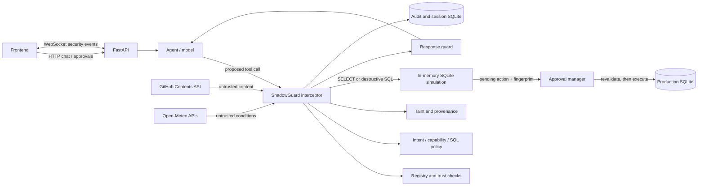

# ShadowGuard AI: execution, security, and performance

This document describes the current backend execution paths, security
boundaries, integration behavior, local benchmark observations, and known
limitations. “Measured” refers only to the local benchmark below; mocked
provider tests do not verify live GitHub or Open-Meteo access.

## Runtime architecture



The backend initializes the audit/session database, production demo database,
model bundle, registry, taint engine, approval manager, shadow simulator, and
remote integration client at application startup. Each proposed tool call
passes through the interceptor before any registered implementation runs.
The API's agent path runs synchronous interceptor work in a worker thread so
network calls and SQLite work do not block the async event loop. The remote
HTTP client is closed with the application lifespan.

## Security and data flows

### External content to a guarded database action

```mermaid
sequenceDiagram
    participant U as User / agent
    participant G as ShadowGuard interceptor
    participant R as Remote provider
    participant T as Taint / provenance
    participant S as Shadow SQLite clone
    participant A as Approval manager
    participant P as Production SQLite
    U->>G: Propose GitHub or weather tool call
    G->>G: Validate tool, trust, policy, and arguments
    G->>R: Fetch allowlisted GitHub file or current weather
    R-->>G: Provider result with provenance
    G->>T: Record returned external fields as untrusted
    G-->>U: Guarded result; session is tainted
    U->>G: Propose database statement
    G->>G: Check SQL policy and taint policy
    G->>S: Clone production DB and simulate eligible SQL
    S-->>G: Impact, samples, and clone fingerprint
    G->>A: Stage exact arguments, hash, expiry, and fingerprint
    A-->>U: Pending approval; no production mutation yet
    U->>A: Approve action
    A->>A: Check expiry, identity, integrity, tool policy, and taint
    A->>P: Recheck fingerprint in write transaction, then execute
    P-->>A: Execution result and terminal approval state
```

- GitHub reads use the Contents API for an allowlisted repository and a
  validated relative path. Returned text is limited to 1 MB and carries a blob
  revision in provenance. The token is read from `GITHUB_TOKEN`; it is not
  returned in provider results.
- Weather uses Open-Meteo geocoding followed by a fresh current-conditions and
  one-day forecast request. Weather results include the provider observation
  time and are not cached.
- Provider payloads remain untrusted even if the tool's registry trust score
  is high. The response guard sanitizes output, and successful GitHub/weather
  results taint the session. Provider failures are explicit errors and do not
  fabricate values or taint the session.
- A database action is simulated on an isolated in-memory backup. SQL policy
  rejects unsupported statements before execution; simulation errors are
  reported as failures rather than zero impact. Destructive SQL requires
  human approval. Approval binds the staged action to an integrity hash,
  session/user, taint-source snapshot, expiry, and production snapshot
  fingerprint.
- At approval time, the backend rechecks the action hash, approval expiry,
  current identity/tool policy, taint sources, SQL policy, and database
  fingerprint. The production fingerprint check and mutation run while holding
  a write transaction, preventing writes from racing between the check and
  execution. A changed snapshot cancels the approval. A resolved approval
  cannot be reused.

## Cache, failure, and observability behavior

Only successful geocoding results are cached. The cache is process-local,
case-insensitive by city name, limited to 128 entries, and expires entries
after 24 hours using a monotonic clock. Expired entries are removed when that
city is next requested; least-recently-used entries are evicted at capacity.
There is no explicit cache invalidation endpoint; restarting the backend also
clears the cache. Current weather is fetched on every call.

HTTP requests use a shared client with an 8-second total timeout, a
2-second connect timeout, and bounded connection/keep-alive pools. Provider
request counts, failures, cumulative duration, and geocoding cache
hits/misses/expirations/evictions are available from the integration metrics
snapshot. Errors are returned with provider-specific policy codes, without
exposing provider response bodies or credentials.

Approvals expire after `APPROVAL_TIMEOUT_SECONDS` (default 300 seconds).
Expiry is enforced when an approval decision is submitted. Persistent grants,
when explicitly chosen, are limited to 24 hours; one-time approval remains the
default.

## Local benchmark

The repeatable benchmark is [`backend/scripts/benchmark_runtime.py`](../backend/scripts/benchmark_runtime.py).
Run it from the backend directory with the project interpreter:

```powershell
python scripts\benchmark_runtime.py --iterations 100 --rows 1000
```

The baseline and post-change runs used 100 iterations and a 1,003-row local
SQLite database. The post-change values below are the ranges from three
invocations, including a validation run for this submission. These are
observations from one local Windows/Python 3.10.8
environment, not statistically controlled results or a production workload.
Remote calls are deliberately excluded.

| Operation | Baseline p50 / p95 | Current p50 range / p95 range | Observation |
| --- | ---: | ---: | --- |
| Trust inference | 26.192 / 33.357 ms | 12.896–13.741 / 14.283–15.866 ms | Lower latency after deriving the class from the already-computed probability output. |
| Intent inference | 1.136 / 1.603 ms | 0.750–0.784 / 1.013–1.319 ms | Lower latency in these runs; the classifier path was not otherwise changed. |
| Shadow simulation | 6.898 / 7.280 ms | 7.240–7.656 / 8.133–8.731 ms | Timing varied across runs; do not claim a simulation latency improvement. |

For shadow simulation, traced SQLite statements decreased from 12 to 11 per
run, and peak Python `tracemalloc` usage decreased from 280.3 KiB to 217.4 KiB
(about 22%). The streaming fingerprint still traverses the full database
dump, so its cost remains proportional to database size. Timing variation and
the additional clone-state/fingerprint work may affect results; benchmark a
representative database before making deployment capacity decisions.

## Changes and residual risks

| Area | Change or current control | Residual risk / follow-up |
| --- | --- | --- |
| Model inference | Trust classification reuses `predict_proba` output instead of making a second model prediction. | Saved model artifacts were created with scikit-learn 1.9.1; the local runtime is 1.7.2 and emits compatibility warnings. Retrain or pin a compatible runtime before relying on those artifacts operationally. |
| Shadow state | Snapshot hashing streams dump statements; table-column metadata is reused within a simulation; failed samples/counts are no longer silently converted to empty values. | Snapshot calculation still walks the full SQLite dump; large production databases may require a more scalable snapshot strategy. |
| External integrations | Live GitHub/Open-Meteo adapters have bounded requests, allowlisting/input validation, provenance, and explicit failures. | Automated tests use mocked HTTP transports. No live provider call has been made as part of this work; check credentials, repository permissions, network policy, and provider availability in the deployment environment. |
| Geocoding | Bounded 24-hour process-local cache; weather itself stays fresh. | No explicit invalidation endpoint; data can remain stale until TTL expiry or process restart. |
| Approval safety | Action integrity, expiry, shared operator bearer token, tool policy, taint sources, and state fingerprint are revalidated; concurrent decisions are serialized. | The token protects decision POSTs only; it does not authenticate individual operators or protect approval-list reads and other API routes. A process failure while an approval is `EXECUTING` has no automatic recovery workflow. |
| Frontend packaging | The approval confirmation dialog requests the token without persistent storage. `npm run build` passed locally with the manifest-resolved Vite 6 toolchain. | No frontend unit-test script is declared; a successful bundle build does not test the browser approval flow. No live provider access is implied by mocked tests. |

The model scores are security signals, not authorization. Current saved models
are trained from synthetic demonstration data; their reported synthetic
metrics do not establish real-world classifier performance. See
[`ml-security-models.md`](./ml-security-models.md) for model behavior and
limitations.
